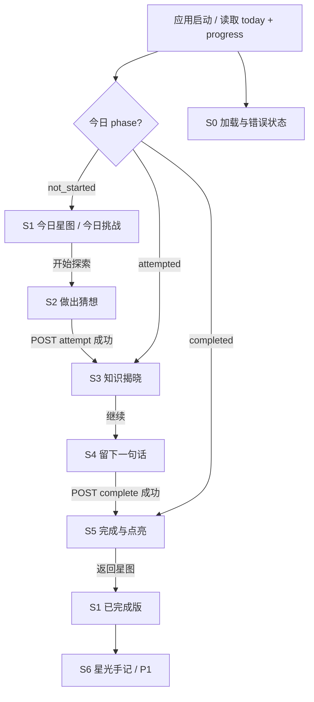

# SparkLab｜产品定义、信息架构与逐屏交互 v0.2

## 1. 产品与评审目标

- **品牌名：** 微光实验室 SparkLab
- **主标语：** 每天 5 分钟，让好奇心发一点光。
- **核心承诺：** 看见一个问题，先做出自己的判断，获得准确解释，留下一句新的理解，并能看见持续积累。
- **受众：** 初中及以上年龄的学生，兼容大学生；题目侧重生活科学、科学思维与学习方法。
- **核心北极星指标（本次仅说明，不可声称实测）：** 用户是否完成一次包含“猜想 + 反思”的微探索。不能仅用页面停留时间或点击次数衡量主动性。
- **设计原则：** 低门槛、高参与、鼓励修正、即时反馈、积累可见。错误猜想不惩罚，反思内容不做 AI 假评分。

### 评审任务严格映射

| 要求 | 实施位置 | 评审如何操作核实 |
|---|---|---|
| 能开始任务 | S1 首页、S2 猜想页 | 当日唯一题目可见，开始按钮可点击 |
| 能完成并获得反馈 | S3 揭晓、S4 反思、S5 完成页 | 提交后立刻显示解释/鼓励/自己的收获，接口落库 |
| 能看见进度 | S1 右侧星轨、S5 完成页 | 7 日记录、连学天数、累计天数刷新保持 |
| 前后端完整 | React + FastAPI + SQLite | Network 中有实际 HTTP 请求，sqlite 有完成记录 |
| 三日交付 | P0 先做、P1 取舍 | 可按 README 在本机启动、演示或提交视频 |

## 2. 信息架构

实现形态：**单页应用**，路由不必复杂；主页面组件根据 `phase` 和本地交互步数切换内容。优先选择不强制弹窗的主卡片渐进式变化，这样移动端也容易用。刷新重新请求后端并恢复：`not_started → S1`、`attempted → S3`、`completed → S5`。

## 3. 全局组件规范

- `AppShell`：星空背景（纯 CSS 渐变 + 稀疏装饰星点）、居中内容容器、导航品牌、演示状态。
- `DailyHeader`：问候语、日期、今天这道题的场景导入。不根据姓名或未提供画像假定身份。
- `ChallengeCard`：一张主卡，承载 S1–S5 的核心交互；内容区域高度尽量稳定，避免骤跳。
- `ProgressPanel`：真实 `streak_days`、`total_completed_days`、本周 7 日星轨。每颗星带“星期+月日+状态”辅助标签。
- `DemoToolbar`（P1）：只有后端 `is_demo_mode=true` 才可见；模拟日期和清空记录必须醒目标识“演示”。
- `StatusToast`：网络异常、提交重试等非阻断反馈；关键错误在主卡内用 inline alert 展示。

## 4. 逐屏说明：S0 加载 / 错误 / 空状态

**进入条件：** 首次进入、刷新、切换演示日期时同时发起 `GET /api/today`、`GET /api/progress`（可 `Promise.all`）；屏幕保持稳定骨架。

**布局：** 导航 logo 始终显示；主卡及右侧成长卡 skeleton，屏幕读屏提示“正在整理今天的星图”。

**成功：** 两份数据返回一致的 `reference_date` 后进入 S1/S3/S5；不要假设 `today.completed` 就自动修改前端连续天数。

**失败：** 显示“星图暂时没连上，请再试一次。”，按钮“重新连接”；不产生模拟完成状态。错误重试再次获取两接口。手机端错误区域仍在首屏清晰可见。

**数据库首次初始化为空：** `streak_days=0`、`total_completed_days=0`；星轨空心是正常状态，不是错误。

## 5. 逐屏说明：S1 今日星图 / 今日挑战

**目标：** 5 秒内看懂「今天学什么」「从哪里开始」「过去进展怎样」。

**布局（桌面）：** 顶部品牌栏；左侧 60% 是月白主卡，右侧 40% 是深蓝星轨卡。底部一行探索理念。**手机端：** 品牌→问候→主卡→成长卡→底部版权/注释。

**主要元素：** 日期 badge、主题标签“生活科学”、任务名、1 句引导语、“预计 3–5 分钟”、主 CTA “开始今天的探索”；右侧真实连续天数、累计完成、7 日星轨。当天 `phase=completed` 时主 CTA 变为“回看今天的发现”，额外标签“今日已点亮”。

**操作：**
- 点击“开始今天的探索”只切换前端主卡到 S2，不算完成、也不写库。
- 手机滚动和触控点至少 44×44px；图标+文本不可只依赖视觉。
- 交互不需要登录；固定演示用户标记。

**Edge：** 今日尚未完成但昨天刚完成，依然显示保留的历史连续天数，避免上午尚未学习就展示“断签”。

## 6. 逐屏说明：S2 我的猜想

**目标：** 让学生先下判断，而不是直接曝光解释。

**布局：** 进度提示 `01 / 03 · 做出猜想`（**不是正确率或完成率**）；题干；3 张选项卡片；低干扰的安心提示；底部 CTA。

**操作：**
1. 初始无选中，`揭晓答案` disabled，提示“选一个你最接近的猜想”。
2. 单选一项时整张选项卡明显描边、单选圆点实心；键盘 Tab 可以聚焦、空格/Enter 选择。
3. 点击 `揭晓答案` → `POST /api/tasks/{task_key}/attempt`；请求期间按钮显示“正在揭晓…”并禁止再次触发。
4. 成功后切换 S3；服务端记录所选 `selected_option`，刷新直接恢复 S3，不再出现新的选择入口。
5. 请求失败：留在 S2、保留已选值、提示“没能揭晓，再试一次”，重试保持相同选择。

**注意：** 不显示红色叉号/排名和扣分。学习时的“猜错”也不失去星星。无“跳过猜想直接完成”的按钮。

## 7. 逐屏说明：S3 知识揭晓

**目标：** 即时给出真实、温和、可理解的学习反馈。

**布局：** 进度 `02 / 03 · 发现原因`；顶部反馈表情/图标（不依赖颜色）；“你的猜想：…”；“更接近事实的是：…”；解释卡片（80–150 字以内，分短段）；一行“关键发现”要点； CTA “写下今天的发现”。

**操作：**
- `was_correct=true`：显示“你发现了关键线索！”，同时可查看正确选项。
- `was_correct=false`：显示“这次猜想和答案不同，但你已经迈出了探索的第一步。”，明确展示正确答案，不可假装选对。
- 点击 CTA → S4；可通过“返回知识卡”在 S4 和 S3 之间切换，不重试 attempt。
- 页面刷新从后端 `attempt` 存档恢复，保证不丢知识解释。

**Edge：** 服务端任务版本不匹配：提示“今天的任务已更新，请刷新星图”，不保存错误任务答案。

## 8. 逐屏说明：S4 一句话收获

**目标：** 将“看过解释”转化为自己的表达，而不是单纯完赛领奖。

**布局：** `03 / 03 · 留住发现`；反思引导；多行文本框（placeholder 示例）；字符计数 `0 / 120`；简短价值说明；主 CTA `点亮今天的星星`。

**规则：** 用户去除首尾空格后按 Unicode code point 数量计，允许 6–120 个字符；前端可用 `Array.from(text.trim()).length`，后端用 Python `len(reflection.strip())`。不以正确与否决定是否完成；不得硬性要求内容“正确”。

**操作：**
- 未满足 6 字符时 disabled，不使用含糊的错误文本。
- 达到合法长度后点击 → `POST /api/tasks/{task_key}/complete`，body 只含 `reflection`；loading 时按钮变 `正在保存星光…`。
- **写入成功后**进入 S5；由返回的 `progress` 更新数字，不能在请求前乐观 +1。
- 网络失败时保留输入，不显示成功弹窗；再次提交服务端幂等。
- 刷新后，若已有 attempt 但尚未 complete，默认恢复 S3；文本可只保留本页运行时，不要求刷新保留草稿（不得谎称已保存）。

**Edge：** 反思为空白、超长、非法任务→4xx 显示清晰反馈；服务端已有完成记录→读取已存档的数据展示 S5，不覆盖第一次提交。

## 9. 逐屏说明：S5 成功点亮 / 已完成回顾

**目标：** 学生知道“我完成了什么”和“我留下了什么”，且成长是准确的。

**布局：** 成功状态图标（一颗星从空心变实心，约 500–700ms）、标题、具体反馈、自己的原文反思、当前真实连学天数、周星轨；两个操作：`回到我的星图` 与 `再看一遍知识卡`（后者只读）。

**状态：** 刚完成使用温和出现动效；刷新后直接显示静态已完成版，不重复大量庆祝动效（避免频繁刺激）。`prefers-reduced-motion` 时禁用所有位移动画。

**核心文案：** 不把 streak=0 误写成“连续 1 天”。不同情况下采用后端数字插值模板，如“已经连续探索 {streak_days} 天”；如当前连续为 0 且刚完成通常重新开始 1 天。

**Edge：** 同日重复访问 / 重复发送请求，始终回显原反思和原完成时刻，进度不会增长。

## 10. 逐屏说明：S6 星光手记（P1）

**目标：** 将用户连续学习的成果从抽象数字变为可回味的知识痕迹。

**进入：** 点击本周已完成的星点或首页“看看我的探索手记”，只有 P1 做完才显示真实入口。

**内容：** 最近最多 7 条真实完成记录，每项：北京时间日期、题目标题、自己写的反思、当天是否猜对（可选，不渲染分数）；列表按日期倒序。空状态：“这里还没有手记。点亮今天的第一颗星，故事就开始了。”

**数据：** `GET /api/history?limit=7`（P1）；后端仅返回参考日期及以前的记录，不能展示模拟参考日之后的“未来历史”。

**交互：** 点击打开只读内容，关闭回主页面；不允许修改已存档反思。

## 11. 逐屏说明：S7 演示时间舱（P1 / 本地）

**展示条件：** `DEMO_MODE=true` 且 API `is_demo_mode=true`，标记“模拟日期·仅用于演示”。

**交互：** 预置“今天 / +1 天 / +2 天 / +4 天”快捷按钮，旁边可手动选 `YYYY-MM-DD`；每次切换均重新请求 `today + progress`；“重置此演示用户”须二次确认，返回实际清除条数，并重查后端数据。

**安全约束：** 正常模式不接受日期覆盖、并不注册重置端点。**公开可访问的部署不应暴露共享 demo 用户的重置能力**；默认把该工具用于本机录屏。需要对外长期演示时，应改为每个浏览器独立匿名会话再发布。

## 12. 状态机与接口对照

| 当前状态 | 操作 | API | 下一状态 | 可恢复行为 |
|---|---|---|---|---|
| S0 | 初始加载 | GET today + progress | S1/S3/S5 | 以 DB 结果为准 |
| S1 | 开始 | 无 | S2 | 不写库 |
| S2 | 揭晓 | POST attempt | S3 | 单次 attempt 由服务端存档 |
| S3 | 写反思 | 无 | S4 | 不写库 |
| S4 | 点亮 | POST complete | S5 | 幂等 completion |
| S5 | 回首页 | 无/GET progress | S1 完成态 | 不重复计数 |
| S5/S1 | 查看手记 | GET history（P1） | S6 | 只读 |
| 任意 | 切模拟日期（P1） | GET today + progress | 依日期恢复 | 数据不穿越 |

## 13. Demo 演示链路和完成标准

**脚本状态（示例）**：固定 demo 用户清空；模拟 11/05 完成 → 11/06 完成 → 11/07 完成 → 11/08 不完成 → 切到 11/09：11/07 连续 3 天，11/08 未学习时仍保留截至昨日的 3 天；11/09 连续为 0，累计仍为 3。题目/日期可在实际录制时使用同样偏移，不能把例子展示为已运行事实。

**P0 完成标准：** 在完全全新数据库下跑通首次任务；提交后 `streak=1`；刷新不增加；错误答案也能进入 S5；断开 API 不会伪装成功；恢复后可继续；测试通过；375/768/1440px 布局无溢出。P1 不影响 P0 验收。
